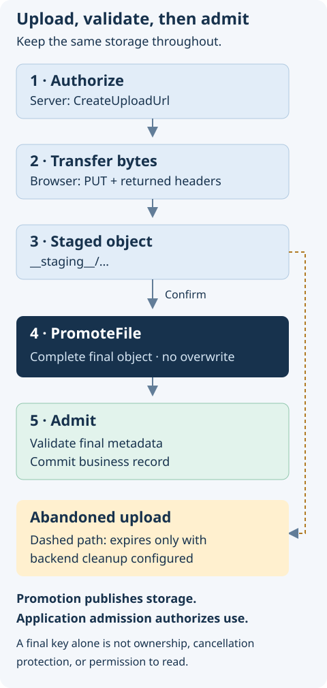

Clients send bytes straight to storage, while your server authorizes uploads and keeps the file references. `@antelopejs/interface-file-storage` defines the contract. An implementing module supplies the backend, the URL signing, and the storage configuration.

## Choose a file workflow

| Your task                             | Start here                                                                                                                                         |
| ------------------------------------- | -------------------------------------------------------------------------------------------------------------------------------------------------- |
| Upload immediately to a fresh key     | [Upload flow](./2.file-operations.md#upload-flow)                                                                                                  |
| Keep abandoned form uploads temporary | [Staging and promotion](./2.file-operations.md#staging-uploads-and-promotion)                                                                      |
| Authorize a download                  | [Download flow](./2.file-operations.md#download-flow) and [visibility](#visibility)                                                                |
| Inspect or remove an object           | [Metadata](./2.file-operations.md#file-metadata) and [deletion](./2.file-operations.md#delete-a-file)                                              |
| Implement a storage backend           | [Provider responsibilities](./2.file-operations.md#provider-and-application-responsibilities) and [conformance tests](#provider-conformance-tests) |

{width="480"}

Before you upload, configure a storage implementation, its credentials, browser CORS, and your application's authorization routes. The examples on these pages make real API calls. They are not an embedded upload demo, so try them with disposable files.

## Core concepts

The interface is built around presigned URLs. File data does not pass through your application server. Clients upload to and download from the storage provider directly, with signed URLs that expire.

| Function          | Purpose                                                       |
| ----------------- | ------------------------------------------------------------- |
| `CreateUploadUrl` | Generate a presigned URL for direct file uploads              |
| `CreateReadUrl`   | Generate a URL to read or download a file                     |
| `ReadFile`        | Read a file's bytes on the server, without a URL              |
| `DeleteFile`      | Remove a file from storage                                    |
| `FileExists`      | Check whether a file exists                                   |
| `GetFileMetadata` | Retrieve metadata for a stored file                           |
| `PromoteFile`     | Move a staged upload out of the staging area to its final key |
| `MoveFile`        | Move a stored object from one resource key to another         |

## Installation

```bash
pnpm add @antelopejs/interface-file-storage
```

## Visibility

The `Visibility` type controls file access. It accepts two values:

| Value       | Description                                                            |
| ----------- | ---------------------------------------------------------------------- |
| `"public"`  | Files are reachable through a direct, permanent URL that never expires |
| `"private"` | Files need a presigned URL that expires                                |

The storage configuration sets the default visibility. To give one file different access, set `UploadRequest.visibility` to `"public"` or `"private"`. If you omit it, the file gets the storage-wide default. The selected visibility survives staging and promotion. `CreateReadUrl` returns a URL without `expiresAt` for a public file, and a URL with an expiration timestamp for a private file.

```ts
import { CreateReadUrl } from "@antelopejs/interface-file-storage";

// For a public file, the URL has no expiration
const publicFile = await CreateReadUrl("uploads/logo.png");
console.log(publicFile.url); // Direct public URL
console.log(publicFile.expiresAt); // undefined

// For a private file, specify an expiration time in seconds
const privateFile = await CreateReadUrl("documents/contract.pdf", 3600);
console.log(privateFile.url); // Presigned URL
console.log(privateFile.expiresAt); // Timestamp when the URL expires
```

## Error classes

The interface defines one error class for upload validation, one for missing files, and one for conflicting promotion destinations.

### `UploadValidationError`

An upload request that violates the constraints throws `UploadValidationError`. Its `code` property names the failed check:

| Code                     | Description                                     |
| ------------------------ | ----------------------------------------------- |
| `"SIZE_EXCEEDED"`        | The file size exceeds the maximum allowed size  |
| `"MIMETYPE_NOT_ALLOWED"` | The file's MIME type is not in the allowed list |

```ts
import {
  CreateUploadUrl,
  UploadValidationError,
} from "@antelopejs/interface-file-storage";

try {
  await CreateUploadUrl(
    { filename: "video.mp4", size: 500_000_000, mimetype: "video/mp4" },
    { maxSize: 10_000_000 },
  );
} catch (error) {
  if (error instanceof UploadValidationError) {
    console.error(`Validation failed [${error.code}]: ${error.message}`);
  }
}
```

### `FileNotFoundError`

An operation on a file that does not exist in storage throws `FileNotFoundError`. Its message names the missing resource key.

```ts
import {
  GetFileMetadata,
  FileNotFoundError,
} from "@antelopejs/interface-file-storage";

try {
  const metadata = await GetFileMetadata("uploads/missing-file.txt");
} catch (error) {
  if (error instanceof FileNotFoundError) {
    console.error(error.message); // "File not found: uploads/missing-file.txt"
  }
}
```

### `FileConflictError`

`PromoteFile` throws `FileConflictError` when the destination belongs to another source, or when the provider cannot verify that the destination is complete. Its `code` is `"FILE_CONFLICT"`, which tells it apart from a missing file. A provider must not report an unknown outcome as a success. To settle an unknown outcome, retry the promotion with the same key and storage.

## Multi-bucket support

Every storage operation takes an optional `storage` argument in last position. It names the storage bucket to use when the implementation has several. Without it, the operation uses the default storage. The [key helpers](./2.file-operations.md#staging-key-helpers) only transform strings and do not select a bucket.

```ts
import { CreateUploadUrl } from "@antelopejs/interface-file-storage";

// Upload to the default storage
await CreateUploadUrl({
  filename: "photo.jpg",
  size: 204800,
  mimetype: "image/jpeg",
});

// Upload to a specific storage bucket
await CreateUploadUrl(
  { filename: "photo.jpg", size: 204800, mimetype: "image/jpeg" },
  undefined,
  "media-bucket",
);
```

## Provider conformance tests

The package ships its shared Mocha suite, compiled from `src/tests` to `dist/tests`. When a provider lists `@antelopejs/interface-file-storage` in `antelopeJs.implements`, `ajs module test` finds that suite and runs it next to the provider's own `test.folder` suites. Do not import or copy the shared tests into a provider.

The suite needs a disposable default storage that accepts explicit public and private uploads, with upload and read URLs reachable over HTTP. It uses only public interface calls and the HTTP headers they return. It creates unique test keys and deletes them after each test. It covers metadata, visibility, immutable uploads, trusted promotion replay, foreign destinations, missing files, and cleanup. Routing, filesystem faults, S3 signatures, and lifecycle rules stay in each provider's own tests.

`pnpm test` in this interface repository runs separate unit tests for the forwarding functions and the key helpers. Those tests use mocks and check the wrappers, not provider conformance. Run the shared suite with each provider's own module runner before a release.

## Next steps

- [File operations](./2.file-operations.md) shows how to upload, download, read, and delete files, and how to work with metadata.
- [Provider promotion contract](./3.provider-contract.md) lists what a storage backend must do to implement `PromoteFile`.
